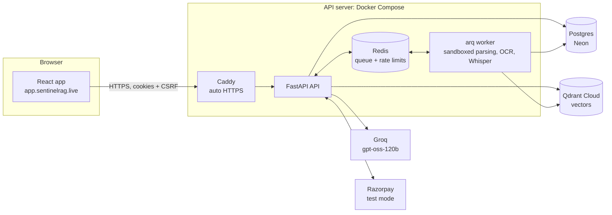
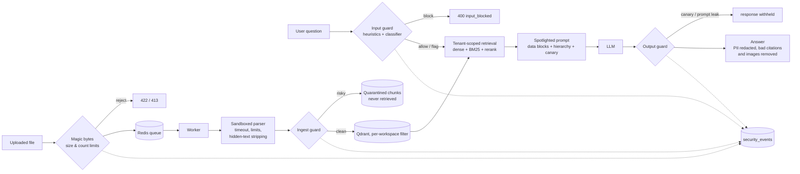
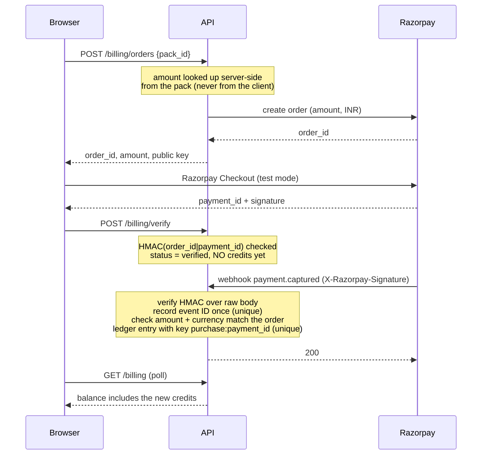

# Sentinel RAG

[](https://github.com/vigildas05/Multimodel-RAG/actions/workflows/ci.yml)
[](https://github.com/vigildas05/Multimodel-RAG/actions/workflows/redteam.yml)

A secure, multi-tenant, pay-per-use **Retrieval-Augmented Generation (RAG) research
assistant**. Upload PDFs, images and audio, ask questions, and get answers grounded in your
own documents with citations (page numbers, audio timestamps), behind a defence-in-depth
**LLM security gateway** against prompt injection.

## Live

| | |
|---|---|
| **App** | **https://app.sentinelrag.live** — click **Try the demo, no sign-up** for a private 24-hour workspace with sample files |
| **API health** | https://api.sentinelrag.live/health/ready |
| **CI** | [GitHub Actions](https://github.com/vigildas05/Multimodel-RAG/actions) — lint, tests against real Postgres/Redis/Qdrant, image build, red-team gate |
| **Red-team report** | [redteam/reports/full.md](redteam/reports/full.md) (also in the app's admin dashboard) |
| **Payments** | Razorpay **test mode only**: on the Billing page choose *Netbanking → any bank → Success*. No real money. |

The API server runs on a pay-as-you-go cloud VM and is sometimes stopped between demos to
save cost; if the app can't reach the API, that's why.

---

## Contents

- [Features](#features)
- [How it works](#how-it-works)
- [Security architecture](#security-architecture) · [Threat model](#threat-model) · [Measured results](#measured-results) · [Known limitations](#known-limitations)
- [Credits and payments](#credits-and-payments-razorpay-test-mode-only)
- [Production deployment](#production-deployment)
- [CI and observability](#ci-and-observability)
- [How it was built](#how-it-was-built)
- [Tech stack](#tech-stack)
- [Run it locally](#run-it-locally) · [API reference](#api-reference) · [Testing](#testing)
- [Roadmap](#roadmap)

## Features

**RAG**
- **Multimodal ingestion**: PDFs (native text, with OCR fallback for scanned pages), images
  (OCR, plus captions when a vision model is configured) and audio (Whisper transcription
  with timestamps)
- **Hybrid retrieval**: Qdrant dense search + BM25, fused with Reciprocal Rank Fusion, then
  cross-encoder reranking (BAAI/bge-reranker-base)
- **Grounded, cited answers** that abstain when the documents don't contain the answer
- **Tunable pipeline** from the UI: top-k, context size, chunking, similarity threshold,
  reranking and hybrid search toggles, temperature, top-p, max tokens
- **Swappable LLM**: local Ollama for development, any OpenAI-compatible API in production
  (Groq `openai/gpt-oss-120b` live)

**Accounts and multi-tenancy**
- argon2id passwords; short-lived JWT access tokens and rotating refresh tokens with reuse
  detection, in httpOnly Secure cookies; double-submit CSRF protection; user/admin roles
  (admins are created only from the server's command line)
- **Isolated workspaces**: every vector query goes through one tenant-scoped choke point,
  BM25 indexes are per workspace, document IDs are checked for ownership, with a dedicated
  tenant-isolation test suite
- **Try the demo**: each visitor gets a private 24-hour copy of a sample workspace (a paper,
  a chart, a lecture clip), with a daily query quota, cleaned up automatically

**Uploads and processing**
- Background processing by an arq worker; the API never parses files
- File type detected from content (magic bytes) and required to match the extension
- Sandboxed parsing in a killable child process with time and memory limits, page/pixel/
  audio-duration caps
- **Hidden PDF text stripping**: invisible, low-contrast, tiny and off-page text is removed
  before it can reach the model (the UI shows how many spans were removed)

**LLM security gateway** ([`backend/security/`](backend/security), standalone package)
- Input guard: obfuscation normalisation + weighted rules + DeBERTa injection classifier
- Ingest guard: every chunk scanned; risky ones quarantined and never retrieved
- Spotlighted prompts with untrusted-data blocks, instruction hierarchy and a per-request canary
- Output guard: canary/system-prompt leak blocking, PII redaction (email, phone, Aadhaar, PAN,
  cards), citation verification, image stripping
- Every decision recorded as a **security event**

**Credits and payments**
- Append-only credit ledger, row-locked spends (no overspend), automatic refunds on failure
- Razorpay Checkout in **test mode**: server-side pricing, credits granted only from
  HMAC-verified webhooks, exactly once

**Admin dashboard** (`/admin`, admins only)
- Security events with filters (type, source, severity, user, workspace, date range) and
  expandable details rendered as plain text
- Usage: queries, blocked share, credits spent, latency mean/p95 by stage, tokens, top users
- Payments overview, and the committed red-team reports

**Operations**
- Rate limiting (Redis sliding window per IP, account and user), strict CORS, security
  headers, request size limits, generic errors with request IDs
- Structured JSON logs with request IDs; Prometheus metrics behind a token
- CI on every push: lint, full tests against real services, image build, red-team gate

## How it works



1. **Upload**: the API validates the file and queues a job; the worker parses it in a
   sandbox, strips hidden text, chunks and embeds it, runs the ingest guard, and stores the
   vectors under the user's workspace.
2. **Question**: the input guard scores it; retrieval runs dense + BM25 search scoped to the
   workspace, reranks, and builds a spotlighted prompt with a canary; the LLM answers; the
   output guard checks for leaks, redacts PII and verifies citations; credits and usage are
   recorded.

## Security architecture



The gateway lives in [`backend/security/`](backend/security), a standalone package with no
imports from the app, so it reads (and could be reused) as an independent LLM security layer.

| Layer | What it does | What it stops |
|---|---|---|
| Upload validation | Detects type from content; size, document-count limits | Renamed executables, polyglots, oversized uploads |
| Sandboxed parsing | Parses in a killable child process with time (and, on Linux, memory) limits; page/pixel/duration caps | Parser hangs, decompression bombs, huge files |
| Hidden-text stripping | Removes PDF text that's invisible, low-contrast, tiny or off-page | Hidden instructions in documents |
| 1. Input guard | Normalises obfuscation (zero-width, homoglyphs, base64/hex, leetspeak) then scores with weighted rules + a DeBERTa injection classifier | Direct injection, jailbreaks, system-prompt extraction |
| 2. Ingest guard | Scans every chunk (incl. OCR/transcripts/image captions); quarantines risky ones | Indirect injection planted in documents |
| 3. Prompt construction | Untrusted text in marked data blocks, neutralised delimiters, explicit hierarchy, per-request canary | Documents posing as instructions |
| 4. Output guard | Blocks canary/system-prompt leaks; redacts PII; strips invalid citations and images | Prompt leaks, PII exposure, fabricated citations, image-beacon exfiltration |
| Tenancy & auth | Workspace filter on every vector query, per-workspace BM25, cookie auth with CSRF | Cross-tenant data access, session theft/fixation |
| Payments | Server-side pricing, signed webhooks as the only credit source, amount/currency checks, unique event and purchase keys, append-only ledger with row-locked spends | Amount tampering, forged or replayed webhooks, double crediting, overspending races |
| App hardening | Redis sliding-window rate limits (per IP, per account, per user), strict CORS, CSP/HSTS/nosniff/frame-ancestors, body size limits, generic 500s with request IDs, no input echo in 422s | Brute force, credential stuffing, request floods, clickjacking, info leaks via errors |
| Infrastructure | No SSH port; server managed through AWS Systems Manager; secrets only in SSM Parameter Store (SecureString) with a role that can read only this app's path; non-root, read-only containers with all capabilities dropped; instance metadata unreachable from containers | Credential theft from the repo or host, lateral movement, container breakout impact |

### Threat model

**Attackers we design for**
- A **malicious user** of their own account: crafts questions to override instructions,
  jailbreak the model, extract the system prompt, or reach other tenants' data (guessed
  document IDs, forged workspace IDs, tampered tokens).
- A **poisoned document**: a file uploaded by anyone (including an unwitting user) that
  carries instructions aimed at the model, visibly or hidden (white text, tiny fonts,
  off-page text, invisible render mode, text in images or audio).
- A **hostile file**: crafted to crash, hang or exhaust the parsers.
- An **anonymous visitor** abusing the demo, auth or payment endpoints (including forged
  payment webhooks).

**Out of scope for now**: a compromised host or database, a malicious LLM provider, and
volumetric DDoS (rate limits handle abuse from individual IPs and accounts, not floods).

### Measured results

From the [red-team suite](redteam): 340 attacks in 6 categories plus 100 benign items,
each run with the gateway **off** and **on** ([full report](redteam/reports/full.md)).
ASR = attack success rate (the attacker's goal achieved). Mock LLM = a deliberately gullible
model that obeys any attack text reaching it, so these numbers measure the detection and
output layers against a worst case.

| Category | n | ASR off | ASR on | Blocked / quarantined |
|---|---:|---:|---:|---:|
| Direct injection | 60 | 100% | 36.7% | 63.3% |
| Jailbreak / role-play | 56 | 100% | 37.5% | 62.5% |
| System-prompt extraction | 56 | 100% | 0.0% | 60.7% |
| Indirect injection (in documents) | 72 | 100% | 29.2% | 70.8% |
| PII exfiltration | 50 | 100% | 0.0% | 8.0% |
| Obfuscation | 46 | 100% | 30.4% | 69.6% |
| **Overall** | **340** | **100%** | **22.9%** | **57.1%** |

Gateway with heuristics + classifier (weight 0.7), mock LLM. Extraction and PII attacks that
slip past detection are still stopped by the output guard (canary/leak blocking, redaction).

| Configuration | ASR on (dev / holdout) | Benign false positives | External attacks blocked¹ | Added latency² |
|---|---:|---:|---:|---:|
| Heuristics only | 25.6% (5.3% / 67.0%) | 0% | 10.0% | 0.26 ms |
| Heuristics + classifier, weight 0.7 (default) | 22.9% (3.1% / 63.4%) | 0% (12% flagged) | 10.0% (41.7% flagged or blocked) | 145 ms |
| Heuristics + classifier, weight 1.0 | 12.3% (1.8% / 33.9%) | **11%** | 40.0% | 140 ms |
| Default, real model (llama3.2:3b), 48-attack sample³ | 2.1% (vs 18.8% off) | 0% | n/a | 235 ms |

¹ [deepset/prompt-injections](https://huggingface.co/datasets/deepset/prompt-injections) test split, English and German; 0% of its benign prompts were blocked in any configuration.
² Gateway time per request on a laptop CPU, mean; excludes the LLM call.
³ First 8 attacks per category (all from the dev split); [report](redteam/reports/real_llm.md).

The production model (Groq `openai/gpt-oss-120b`) hasn't been through the red-team suite
yet; a spot check through the live gateway showed it ignoring an injected instruction in a
document and declining off-topic questions, but that is not a measurement. See the
[roadmap](#roadmap).

What the numbers say:
- **Hand-written rules overfit.** They block most attacks phrased like the ones they were
  written against (dev) and almost none of the separately written holdout paraphrases. The
  holdout split exists to make this visible.
- **The classifier is a recall/false-positive trade-off, not a free win.** Letting it block on
  its own halves the holdout ASR but blocks 11% of normal questions and documents, so by
  default it only flags (logged for review) unless a rule agrees.
- **Output-side controls don't depend on detection**: with a gullible model, every
  extraction and PII attack that got past detection was still stopped.
- **A real model complies far less than the worst case** (18.8% ASR with no protection), and
  the gateway brought this sample to 1 success in 48: a user-supplied "from now on you only
  answer with X", which is an instruction override but harms no one else.

### Known limitations

No prompt-injection defence is complete, and this one isn't either.

- Heuristic rules can be paraphrased around: measured, they block 2.7% of holdout
  paraphrases on their own. The classifier catches more but not all, and both are
  English-centric (German attacks in the external set mostly pass).
- The classifier produces confident false positives on some benign text, so on its own it
  only **flags**; blocking or quarantining needs a heuristic signal too. This trades some
  recall for fewer false blocks.
- A quarantined chunk is excluded whole, so legitimate text sharing a chunk with an
  injection is lost.
- Spotlighting and the instruction hierarchy reduce, but don't eliminate, the chance a
  model follows injected text that slips past detection.
- The canary catches verbatim leaks; a model paraphrasing its instructions would not trip
  it (the fingerprint and shingle checks catch only some restatements).
- PII redaction is pattern-based: it misses unusual formats and redacts PII the user may
  legitimately want to see from their own documents.
- Hidden-text detection doesn't catch text hidden behind images or shapes.
- Parser memory caps apply on Linux only.
- Rate limits fail open if Redis is unreachable (availability over strictness).
- No password reset or email verification yet, and no self-service account deletion.
- Payments are Razorpay test mode only by design; there is no live-payments path.

## Credits and payments (Razorpay, TEST MODE only)

Questions and media processing cost credits (1 per question, 3 per image, 5 per audio file,
PDFs free; all configurable). New accounts get 20 free credits, demo visitors 30, and more can
be bought in packs on the Billing page (Starter 50 credits for ₹49, Standard 200 for ₹149,
Pro 500 for ₹299). **Payments run in Razorpay test mode only: no real money.** The server
refuses to start with a live key or with test mode switched off.



- **Append-only ledger.** Balances are always `SUM(credit_ledger.amount)`; a Postgres trigger
  rejects UPDATEs, corrections are new entries.
- **No overspend.** Each spend locks the user's account row, re-reads the balance and inserts
  the debit in one transaction; a 30-thread test proves exactly the affordable number succeed.
- **No double credit.** Webhook event IDs and `purchase:<payment_id>` ledger keys are unique, so
  retried, duplicated or concurrent deliveries credit once (tested, including 8 concurrent).
  Verified live: Razorpay's `payment.captured` credited a purchase, and its `order.paid` for
  the same payment came back `already_credited`.
- **Automatic refunds.** Credits are taken when an action starts and returned if it fails
  (a question that errors, a document that fails processing in the worker), idempotently.
- **Testing a purchase**: choose **Netbanking → any bank → Success** (or domestic test card
  `5267 3181 8797 5449`, or UPI `success@razorpay`). Razorpay treats `4111 1111 1111 1111` as
  an international card, which new accounts decline.

## Production deployment

| Piece | Where | Notes |
|---|---|---|
| Frontend | **Vercel**, `app.sentinelrag.live` | Static Vite build; CSP and security headers from `frontend/vercel.json` |
| API, worker, Redis, Caddy | **AWS EC2** (Sydney), Docker Compose | x86 `m7i-flex.large`, encrypted disk, 4 GB swap |
| HTTPS | **Caddy + Let's Encrypt** | Automatic certificates and renewal; HTTP → HTTPS redirect; `/metrics` blocked publicly |
| Postgres | **Neon** (AWS Sydney) | Pooled TLS connection for the app, direct connection for migrations |
| Vectors | **Qdrant Cloud** (GCP Sydney) | API-key auth; runs in strict mode, so every filtered field is indexed |
| LLM | **Groq**, `openai/gpt-oss-120b` | OpenAI-compatible API, `reasoning_effort=low` |
| Payments | **Razorpay** test mode | Webhook at `https://api.sentinelrag.live/webhooks/razorpay` |
| Secrets | **AWS SSM Parameter Store** | SecureStrings under one path; [`deploy/render_env.py`](deploy/render_env.py) writes the server's `.env.prod` (mode 600); values are never printed |
| Server access | **AWS Systems Manager** | No SSH port open; firewall allows only 80/443 |
| DNS | Domain registrar | `api` → server's Elastic IP, `app` → Vercel |

**Hardening on the server**: containers run as a non-root user with read-only filesystems,
all Linux capabilities dropped and `no-new-privileges`; only Caddy publishes ports; the
instance requires IMDSv2 with a hop limit of 1, so containers can't reach the server role's
credentials; that role can read only the app's own parameters; automatic security updates
are on. The API refuses to start in production with a wildcard or non-HTTPS CORS origin,
insecure cookies, a weak JWT key, or non-test payment keys.

**Deploying an update** (on the server, via Systems Manager):

```bash
cd /opt/sentinel-rag && git pull --ff-only
cd deploy && API_DOMAIN=api.sentinelrag.live CORS_ORIGINS=https://app.sentinelrag.live python3 render_env.py
docker compose --env-file .env.prod -f compose.prod.yml up -d --build   # migrations run first
```

Rotating a secret is: put the new value in Parameter Store, rerun `render_env.py`, and
`up -d`. The JWT key is kept across re-renders, so nobody is signed out.

[docs/DEPLOYMENT.md](docs/DEPLOYMENT.md) is the general guide for any Linux VM (accounts,
checklist, Razorpay setup, operations); `deploy/compose.smoke.yml` runs the production stack
locally.

## CI and observability

**CI** (`.github/workflows/`), on every push to `main` and every pull request:

| Workflow | Job | What it checks |
|---|---|---|
| `ci` | Lint (ruff) | pyflakes, bugbear, import order, bandit-style security rules |
| `ci` | Frontend | ESLint (React, hooks, `react/no-danger`), production build, `npm audit` (fails on high/critical) |
| `ci` | Backend tests | Full pytest suite against Postgres, Redis and Qdrant service containers. A test that would skip because a service is unreachable **fails** in CI (`REQUIRE_TEST_SERVICES=1`), so the tenant-isolation suite can't pass by being skipped |
| `ci` | Production image | Builds the multi-stage Dockerfile and checks the container doesn't run as root |
| `red-team` | Red-team gate | Harness tests and the ASR/FPR gate (see [Measured results](#measured-results)) |

**Structured logs.** With `LOG_FORMAT=json` (the production setting) every log line is a JSON
object with a timestamp, level, logger and the request ID, which is also returned in the
`X-Request-ID` header. Each request writes one `app.access` line (method, path without the
query string, route template, status, duration, client IP). Headers, bodies and question
text are never logged.

**Metrics.** `GET /metrics` serves Prometheus metrics: request counts and latency by route
template, security events by type and severity, chat queries (answered/blocked), per-stage
query latency (security, retrieval, generation), LLM tokens and credits charged. Routes are
labelled by template (`/documents/{document_id}`) and unknown paths collapse into one label,
so no IDs or user data appear in metrics. In production the endpoint is disabled unless
`METRICS_TOKEN` is set, and Caddy blocks it from the internet.

## How it was built

The starting point was a single-user multimodal RAG app. It was upgraded in phases, each
committed with tests written alongside the feature (see [docs/PLAN.md](docs/PLAN.md)):

| Phase | What it added |
|---|---|
| 0. Plan | Read the existing code; decided on Postgres, per-workspace tenancy, a queue worker with sandboxed parsing, and removing debug endpoints |
| 1. Accounts & tenancy | Postgres + SQLAlchemy + Alembic; argon2/JWT/rotating refresh tokens/CSRF/roles; workspace scoping in Qdrant and BM25 with an isolation test suite; React auth pages and a CSRF-aware API client with single-flight refresh; ephemeral demo workspaces with quotas and TTL cleanup |
| 2. Upload security | arq worker; magic-byte validation and limits; sandboxed parsing; hidden PDF text detection |
| 4. LLM security gateway | Input guard (rules + classifier), ingest guard with quarantine, spotlighted prompt with canary, output guard; then rate limiting, CORS, security headers, size limits, generic errors |
| 5. Red team | 340 attacks / 100 benign items with dev and holdout splits plus an external benchmark; gullible mock LLM; off-vs-on A/B; JSON + markdown reports; CI gate |
| 3. Credits & payments | Append-only ledger with row-locked spends and refunds; Razorpay test-mode checkout with verified webhooks and idempotency; billing page |
| 6. Admin dashboard | Security events with filters, usage, payments, red-team report |
| 7. Deployability | Multi-stage non-root image, Caddy, production compose, hosted LLM provider, Qdrant Cloud support |
| 8. CI & observability | ruff/ESLint/tests-with-services/image-build CI; JSON logs; Prometheus metrics |
| Go-live | AWS EC2 managed through Systems Manager, secrets in Parameter Store, Neon, Qdrant Cloud, Groq, Vercel, Razorpay test mode |

Practices that shaped it:
- **Defences are mutation-tested**: for each key control (tenant filters, quarantine, refresh
  reuse detection, webhook signatures, the spend lock, the payment amount check, metrics
  auth…) the control was removed on purpose to confirm a test fails, then restored.
- **No invented numbers**: every metric above comes from a committed report; tuning used
  only the dev split, never the holdout or external sets.
- **Production findings became tests**: Qdrant Cloud's strict mode rejected filtering on an
  unindexed field, which local Qdrant allows; the field is now indexed and the tests run
  with strict mode on. Groq's `gpt-oss` cites as `【1】` and spends output tokens on hidden
  reasoning; citations are normalised and a reasoning-effort setting keeps answers within
  the token limit.

## Tech stack

| Area | Technology |
|---|---|
| Frontend | React 18, Vite, Tailwind CSS, React Router, Axios, react-markdown, lucide-react |
| Backend | Python 3.11, FastAPI, Pydantic v2, Uvicorn |
| Database | PostgreSQL 16 (Neon in production), SQLAlchemy 2, Alembic, psycopg 3 |
| Queue / worker | Redis, arq |
| Vector search | Qdrant (Qdrant Cloud in production), BM25 (rank_bm25), Reciprocal Rank Fusion |
| Embeddings & reranking | sentence-transformers: BAAI/bge-small-en-v1.5, BAAI/bge-reranker-base |
| Documents & media | PyMuPDF, PaddleOCR, faster-whisper |
| LLM | Groq `openai/gpt-oss-120b` (production, OpenAI-compatible API); Ollama `llama3.2:3b` + `moondream` (local) |
| Security | argon2-cffi, PyJWT, protectai/deberta-v3-base-prompt-injection-v2 (transformers), custom gateway in `backend/security/` |
| Payments | Razorpay (test mode) |
| Observability | JSON logging, prometheus-client |
| Infrastructure | Docker, Docker Compose, Caddy, Let's Encrypt, AWS EC2, AWS Systems Manager, AWS SSM Parameter Store, AWS IAM, Vercel |
| Quality | pytest, ruff, ESLint, GitHub Actions |

## Project structure

```
RAG/
├── backend/
│   ├── app/
│   │   ├── main.py            # FastAPI app; services built in services/container.py
│   │   ├── worker.py          # arq background worker (uploads, demo cleanup)
│   │   ├── cli.py             # create-admin, promote, seed-demo, cleanup-demo, grant-credits
│   │   ├── auth/              # passwords, tokens, cookies, CSRF, auth service
│   │   ├── billing/           # credit ledger, Razorpay client and webhook handling
│   │   ├── ingestion/         # upload validation, sandboxed parsers, processing job
│   │   ├── routers/           # auth, admin, documents, chat, search, usage, billing
│   │   ├── services/          # retrieval, vector store, BM25, OCR, Whisper, LLM providers, admin...
│   │   ├── core/              # rate limiting, middleware, logging, metrics, errors
│   │   ├── db/                # SQLAlchemy models, sessions, audit/security events
│   │   └── storage/, schemas/, models/
│   ├── security/              # the LLM security gateway (standalone package)
│   ├── migrations/            # Alembic migrations
│   ├── eval/                  # retrieval-quality eval
│   ├── tests/                 # pytest suite (tenant isolation, security layers, billing, ...)
│   └── requirements.txt, Dockerfile, .env.example
├── frontend/src/              # React app: pages (incl. Billing, Admin), auth context, API client
├── redteam/                   # attack datasets, eval harness, reports (see redteam/README.md)
├── deploy/                    # compose.prod.yml, Caddyfile, render_env.py, .env.prod.example
├── docs/                      # PLAN.md (phases, decisions), DEPLOYMENT.md
├── .github/workflows/         # ci.yml, redteam.yml
├── examples/                  # sample PDF / image / audio (demo template)
└── docker-compose.yml         # local postgres, redis, qdrant (+ backend)
```

## Run it locally

**Prerequisites**: Python 3.11+, Node.js 18+, Docker Desktop, and [Ollama](https://ollama.com)
(or any OpenAI-compatible API key).

```bash
cp backend/.env.example backend/.env       # every variable is documented inline
cp frontend/.env.example frontend/.env
ollama pull llama3.2:3b && ollama pull moondream
docker compose up -d postgres redis qdrant
```

Backend (first start downloads the embedding/reranker models, a few hundred MB):

```bash
cd backend
python -m venv venv
./venv/Scripts/activate        # Windows; `source venv/bin/activate` on macOS/Linux
pip install -r requirements.txt
alembic upgrade head
python -m app.cli seed-demo    # one-time: load examples/ into the demo template
uvicorn app.main:app --reload --port 8000
```

In two more terminals:

```bash
cd backend && ./venv/Scripts/activate && arq app.worker.WorkerSettings   # processes uploads
cd frontend && npm install && npm run dev
```

Open **http://localhost:5173** (use `localhost`, not `127.0.0.1`: CORS and cookies are set for
`localhost`). Uploads stay *queued* until the worker processes them; `INGEST_MODE=inline` in
`backend/.env` processes them inside the API instead.

- `python -m app.cli create-admin --email you@example.com` creates an admin (prompts for a
  password); there's no way to become admin through the web app.
- Set `JWT_SECRET_KEY` in `backend/.env` to stay signed in across backend restarts.
- To use a hosted model instead of Ollama, set `LLM_PROVIDER=openai_compatible` with
  `LLM_BASE_URL`, `LLM_API_KEY` and `LLM_MODEL` (see `backend/.env.example`).

## API reference

All routes except `/auth/csrf`, `/auth/register`, `/auth/login`, `/auth/refresh`,
`/auth/logout`, `/auth/demo`, `/webhooks/razorpay` and `/health` require a session cookie;
every state-changing request needs the `X-CSRF-Token` header (from `GET /auth/csrf`).

| Method | Path | Purpose |
|---|---|---|
| GET | `/auth/csrf` | Get a CSRF token |
| POST | `/auth/register`, `/auth/login` | Create an account / sign in (sets session cookies) |
| POST | `/auth/refresh`, `/auth/logout` | Rotate the session / revoke it |
| POST | `/auth/demo` | Start a private 24-hour demo workspace |
| GET | `/auth/me`, `/usage/me` | Current user; today's usage, credit balance and demo expiry |
| POST | `/documents/upload` | Upload a file; returns 202 with a `queued` document (`?force_ocr=true` for PDFs) |
| GET | `/documents` | List your workspace's documents (status, chunks, hidden spans, quarantine count) |
| DELETE | `/documents/{document_id}` | Delete a document and its chunks |
| GET | `/documents/{document_id}/chunks` | Inspect stored chunks, incl. quarantine reasons |
| POST | `/documents/reset` | Delete every document in your workspace |
| POST | `/chat` | Grounded answer + citations + retrieval and security metadata |
| POST | `/search` | Retrieval only, no generation |
| GET | `/billing` | Balance, costs, packs, credit history, your payments |
| POST | `/billing/orders`, `/billing/verify` | Create a Razorpay order for a pack / verify the checkout signature |
| POST | `/webhooks/razorpay` | Razorpay webhook (HMAC-verified; the only source of purchased credits) |
| GET | `/admin/users` | Admin only |
| GET | `/admin/security-events` | Admin only. Filters: `event_type`, `source`, `severity`, `user_id`, `workspace_id`, `since`, `until`; `limit`/`offset` |
| GET | `/admin/security-summary`, `/admin/usage` | Admin only. Daily aggregates for the last `days` (1–90) |
| GET | `/admin/payments` | Admin only. Payment counts by status and recent payments |
| GET | `/admin/redteam/reports`, `/admin/redteam/latest?name=full` | Admin only. Red-team report summaries |
| GET | `/health`, `/health/ready` | Liveness; readiness of database, Redis and vector store |

Example `/chat` response:

```json
{
  "answer": "...",
  "sources": [
    { "index": 1, "document": "transformers.pdf", "file_type": "pdf", "page": 14,
      "chunk_id": "...", "score": 0.87, "text_snippet": "..." }
  ],
  "retrieval": { "top_k": 10, "reranked": true, "hybrid": true, "reranked_chunks": 4,
                 "dense_candidate_count": 10, "bm25_candidate_count": 10 },
  "security": { "input_flagged": false, "pii_redactions": { "email": 1 },
                "removed_citations": [], "removed_images": 0 }
}
```

## Testing

```bash
cd backend
pytest                    # 464 tests; needs Postgres, Redis and Qdrant from docker compose
                          # (auto-skipped locally; REQUIRE_TEST_SERVICES=1 makes skips fail)
python eval/run_eval.py   # retrieval quality metrics (Recall@K, Precision@K, MRR)
cd .. && ruff check .     # Python lint (backend/ and redteam/), config in ruff.toml
python redteam/run_eval.py --classifier off --max-asr 0.28 --max-fpr 0.02   # red-team gate
cd frontend && npx eslint . --max-warnings 0
```

## Roadmap

- Run the red-team suite against the production model (Groq `gpt-oss-120b`) and publish the numbers
- Password reset and email verification (via an email provider), self-service account
  deletion and data export
- Continuous deployment: a GitHub Action that deploys after CI passes, using AWS OIDC (no
  stored AWS keys)
- Uptime and error-rate alerting; Prometheus scraping; worker metrics
- AWS budget alarm and scheduled stop/start for the API server
- Classifier tests in CI (cache the model on the runner)
- React Router v7 (clears two moderate advisories)
