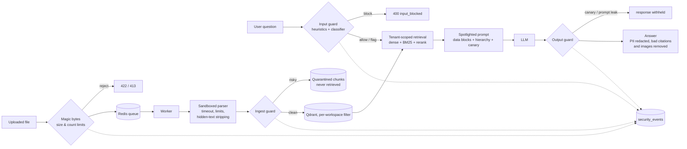

# Sentinel RAG

A secure, multi-tenant Retrieval-Augmented Generation (RAG) research assistant. Upload PDFs,
images and audio, ask questions, and get answers grounded in your own documents with
citations (page numbers, audio timestamps), behind a defence-in-depth **LLM security
gateway** against prompt injection.

The retrieval pipeline is real: dense + BM25 hybrid search, cross-encoder reranking, OCR for
scanned documents, Whisper for audio, and a swappable local/hosted LLM backend.

## Features

**RAG**
- **Multimodal ingestion**: PDFs (native text or OCR fallback), images (OCR + vision
  captioning) and audio (Whisper transcription with timestamps)
- **Hybrid retrieval**: Qdrant dense search + BM25, fused with Reciprocal Rank Fusion, then
  optional cross-encoder reranking (BAAI/bge-reranker-base)
- **Grounded, cited answers**: abstains when the documents don't contain the answer
- **Configurable pipeline**: top-k, context size, chunking, threshold, temperature, etc.
  from the UI

**SaaS & isolation**
- **Accounts**: argon2id passwords, short-lived JWT access tokens and rotating refresh tokens
  (reuse detection) in httpOnly cookies, CSRF protection, user/admin roles
- **Isolated workspaces**: every Qdrant query is filtered by workspace in one choke point,
  BM25 indexes are per workspace, with a dedicated tenant-isolation test suite
- **Try-the-demo**: per-visitor, 24-hour copies of a sample workspace, with daily quotas
- **Background processing**: uploads are processed by an arq worker; the API never parses
  files or loads OCR/Whisper

**Security** (see [Security architecture](#security-architecture))
- Upload hardening: magic-byte type detection, size/page/pixel/duration limits, sandboxed
  parsing with hard timeouts, hidden-PDF-text stripping
- LLM security gateway: input guard (heuristics + ML classifier), ingest guard
  (quarantine), spotlighted prompts with a canary, output guard (leak blocking, PII
  redaction, citation checks, image stripping)
- Every security decision is recorded as a security event

## Credits and payments (Razorpay, TEST MODE only)

Questions and media processing cost credits (1 per question, 3 per image, 5 per audio file,
PDFs free; all configurable). New accounts get 20 free credits, demo visitors 30, and more can
be bought in packs on the Billing page. **Payments run in Razorpay test mode only: no real
money.** The server refuses to start with a live key or with test mode switched off.


- **Append-only ledger.** Balances are always `SUM(credit_ledger.amount)`; a Postgres trigger
  rejects UPDATEs, corrections are new entries.
- **No overspend.** Each spend locks the user's account row, re-reads the balance and inserts
  the debit in one transaction; a 30-thread test proves exactly the affordable number succeed.
- **No double credit.** Webhook event IDs and `purchase:<payment_id>` ledger keys are unique, so
  retried, duplicated or concurrent deliveries credit once (tested, including 8 concurrent).
- **Automatic refunds.** Credits are taken when an action starts and returned if it fails
  (a question that errors, a document that fails processing in the worker), idempotently.

## Security architecture



The gateway lives in [`backend/security/`](backend/security), a standalone package with no
imports from the app, so it reads (and could be reused) as an independent LLM security layer.

| Layer | What it does | What it stops |
|---|---|---|
| Upload validation | Detects type from content; size, document-count limits | Renamed executables, polyglots, oversized uploads |
| Sandboxed parsing | Parses in a killable child process with time (and, on Linux, memory) limits; page/pixel/duration caps | Parser hangs, decompression bombs, huge files |
| Hidden-text stripping | Removes PDF text that's invisible, low-contrast, tiny or off-page | Hidden instructions in documents |
| 1. Input guard | Normalises obfuscation (zero-width, homoglyphs, base64/hex, leetspeak) then scores with weighted rules + a DeBERTa injection classifier | Direct injection, jailbreaks, system-prompt extraction |
| 2. Ingest guard | Scans every chunk (incl. OCR/transcripts/image captions); quarantines risky ones | Indirect injection planted in documents |
| 3. Prompt construction | Untrusted text in marked data blocks, neutralised delimiters, explicit hierarchy, per-request canary | Documents posing as instructions |
| 4. Output guard | Blocks canary/system-prompt leaks; redacts PII; strips invalid citations and images | Prompt leaks, PII exposure, fabricated citations, image-beacon exfiltration |
| Tenancy & auth | Workspace filter on every vector query, per-workspace BM25, cookie auth with CSRF | Cross-tenant data access, session theft/fixation |
| Payments | Server-side pricing, signed webhooks as the only credit source, amount/currency checks, unique event and purchase keys, append-only ledger with row-locked spends | Amount tampering, forged or replayed webhooks, double crediting, overspending races |
| App hardening | Redis sliding-window rate limits (per IP, per account, per user), strict CORS, CSP/HSTS/nosniff/frame-ancestors, body size limits, generic 500s with request IDs, no input echo in 422s | Brute force, credential stuffing, request floods, clickjacking, info leaks via errors |

### Threat model

**Attackers we design for**
- A **malicious user** of their own account: crafts questions to override instructions,
  jailbreak the model, extract the system prompt, or reach other tenants' data (guessed
  document IDs, forged workspace IDs, tampered tokens).
- A **poisoned document**: a file uploaded by anyone (including an unwitting user) that
  carries instructions aimed at the model, visibly or hidden (white text, tiny fonts,
  off-page text, invisible render mode, text in images or audio).
- A **hostile file**: crafted to crash, hang or exhaust the parsers.
- An **anonymous visitor** abusing the demo or auth endpoints.

**Out of scope for now**: a compromised host or database, a malicious LLM provider, and
volumetric DDoS (rate limits handle abuse from individual IPs and accounts, not floods).

### Measured results

From the [red-team suite](redteam): 340 attacks in 6 categories plus 100 benign items,
each run with the gateway **off** and **on** ([full report](redteam/reports/full.md)).
ASR = attack success rate (the attacker's goal achieved). Mock LLM = a deliberately gullible
model that obeys any attack text reaching it, so these numbers measure the detection and
output layers against a worst case.

| Category | n | ASR off | ASR on | Blocked / quarantined |
|---|---:|---:|---:|---:|
| Direct injection | 60 | 100% | 36.7% | 63.3% |
| Jailbreak / role-play | 56 | 100% | 37.5% | 62.5% |
| System-prompt extraction | 56 | 100% | 0.0% | 60.7% |
| Indirect injection (in documents) | 72 | 100% | 29.2% | 70.8% |
| PII exfiltration | 50 | 100% | 0.0% | 8.0% |
| Obfuscation | 46 | 100% | 30.4% | 69.6% |
| **Overall** | **340** | **100%** | **22.9%** | **57.1%** |

Gateway with heuristics + classifier (weight 0.7), mock LLM. Extraction and PII attacks that
slip past detection are still stopped by the output guard (canary/leak blocking, redaction).

| Configuration | ASR on (dev / holdout) | Benign false positives | External attacks blocked¹ | Added latency² |
|---|---:|---:|---:|---:|
| Heuristics only | 25.6% (5.3% / 67.0%) | 0% | 10.0% | 0.26 ms |
| Heuristics + classifier, weight 0.7 (default) | 22.9% (3.1% / 63.4%) | 0% (12% flagged) | 10.0% (41.7% flagged or blocked) | 145 ms |
| Heuristics + classifier, weight 1.0 | 12.3% (1.8% / 33.9%) | **11%** | 40.0% | 140 ms |
| Default, real model (llama3.2:3b), 48-attack sample³ | 2.1% (vs 18.8% off) | 0% | n/a | 235 ms |

¹ [deepset/prompt-injections](https://huggingface.co/datasets/deepset/prompt-injections) test split, English and German; 0% of its benign prompts were blocked in any configuration.
² Gateway time per request on a laptop CPU, mean; excludes the LLM call.
³ First 8 attacks per category (all from the dev split); [report](redteam/reports/real_llm.md).

What the numbers say:
- **Hand-written rules overfit.** They block most attacks phrased like the ones they were
  written against (dev) and almost none of the separately written holdout paraphrases. The
  holdout split exists to make this visible.
- **The classifier is a recall/false-positive trade-off, not a free win.** Letting it block on
  its own halves the holdout ASR but blocks 11% of normal questions and documents, so by
  default it only flags (logged for review) unless a rule agrees.
- **Output-side controls don't depend on detection**: with a gullible model, every
  extraction and PII attack that got past detection was still stopped.
- **A real model complies far less than the worst case** (18.8% ASR with no protection), and
  the gateway brought this sample to 1 success in 48: a user-supplied "from now on you only
  answer with X", which is an instruction override but harms no one else.

### Known limitations

No prompt-injection defence is complete, and this one isn't either.

- Heuristic rules can be paraphrased around: measured, they block 2.7% of holdout
  paraphrases on their own. The classifier catches more but not all, and both are
  English-centric (German attacks in the external set mostly pass).
- The classifier produces confident false positives on some benign text, so on its own it
  only **flags**; blocking or quarantining needs a heuristic signal too. This trades some
  recall for fewer false blocks.
- A quarantined chunk is excluded whole, so legitimate text sharing a chunk with an
  injection is lost.
- Spotlighting and the instruction hierarchy reduce, but don't eliminate, the chance a
  model follows injected text that slips past detection. Small local models follow
  instructions less reliably.
- The canary catches verbatim leaks; a model paraphrasing its instructions would not trip
  it (the fingerprint check catches only some verbatim fragments).
- PII redaction is pattern-based: it misses unusual formats and redacts PII the user may
  legitimately want to see from their own documents.
- Hidden-text detection doesn't catch text hidden behind images or shapes.
- Parser memory caps apply on Linux only.
- Rate limits fail open if Redis is unreachable (availability over strictness).
- Frontend security headers (CSP for the React app) are set at deployment; the admin
  dashboard UI isn't built yet (its payments API exists).
- Payments are Razorpay test mode only by design; there is no live-payments path.

## Tech stack

| Layer | Technology |
|---|---|
| Frontend | React, Vite, Tailwind CSS, Axios, react-markdown, lucide-react |
| Backend | Python, FastAPI, Pydantic v2, Uvicorn |
| PDF extraction | PyMuPDF |
| OCR | PaddleOCR |
| Speech-to-text | faster-whisper |
| Embeddings | sentence-transformers, BAAI/bge-small-en-v1.5 |
| Reranking | sentence-transformers CrossEncoder, BAAI/bge-reranker-base |
| Sparse retrieval | rank_bm25 |
| Vector DB | Qdrant |
| LLM generation & vision | Ollama (local, default: `llama3.2:3b` + `moondream`) |
| Database | PostgreSQL (SQLAlchemy + Alembic) |
| Queue / worker | Redis + arq |
| Injection classifier | protectai/deberta-v3-base-prompt-injection-v2 (transformers) |
| Infra | Docker, Docker Compose |

## Project structure

```
RAG/
├── backend/
│   ├── app/
│   │   ├── main.py            # FastAPI app; services built in services/container.py
│   │   ├── worker.py          # arq background worker (uploads, demo cleanup)
│   │   ├── cli.py             # create-admin, seed-demo, cleanup-demo
│   │   ├── auth/              # passwords, tokens, cookies, CSRF, auth service
│   │   ├── ingestion/         # upload validation, sandboxed parsers, processing job
│   │   ├── routers/           # auth, admin, documents, chat, search, usage
│   │   ├── services/          # retrieval, vector store, BM25, OCR, Whisper, demo, quota...
│   │   ├── db/                # SQLAlchemy models, sessions, audit/security events
│   │   └── storage/, schemas/, models/, core/
│   ├── security/              # the LLM security gateway (standalone package)
│   ├── migrations/            # Alembic migrations
│   ├── eval/                  # retrieval-quality eval
│   ├── tests/                 # pytest suite (incl. tenant isolation, security layers)
│   └── requirements.txt, Dockerfile, .env.example
├── frontend/src/              # React app: pages, auth context, API client, components
├── redteam/                   # attack datasets, eval harness, reports (see redteam/README.md)
├── .github/workflows/         # CI: red-team gate
├── docker/postgres/init/      # creates the test database
├── examples/                  # sample PDF / image / audio (demo template)
├── docs/PLAN.md               # phased plan and design decisions
└── docker-compose.yml         # postgres, redis, qdrant (+ backend)
```

## Prerequisites

- Python 3.11+
- Node.js 18+
- Docker Desktop
- [Ollama](https://ollama.com) installed and running

## Setup

### 1. Environment variables

```bash
cp backend/.env.example backend/.env
cp frontend/.env.example frontend/.env
```

Every variable is documented inline in `backend/.env.example`. No API key is needed with
the default Ollama setup.

### 2. Pull the Ollama models

```bash
ollama pull llama3.2:3b
ollama pull moondream
```

(Sized to run on a 4GB-VRAM GPU. Swap in larger models — e.g. `llama3.1:8b`, `llava` — in
`.env` if you have more VRAM to spare.)

### 3. Start Postgres, Redis and Qdrant

```bash
docker compose up -d postgres redis qdrant
```

The backend creates the `chunks_v2` collection automatically on first startup — no
manual setup needed. Qdrant's dashboard is browsable at `http://localhost:6333/dashboard`.
Postgres also gets a separate `sentinel_test` database for the test suite.

### 4. Run the backend

```bash
cd backend
python -m venv venv
./venv/Scripts/activate        # Windows; use `source venv/bin/activate` on macOS/Linux
pip install -r requirements.txt
alembic upgrade head           # create / migrate the Postgres schema
python -m app.cli seed-demo    # one-time: load examples/ into the demo template
uvicorn app.main:app --reload --port 8000
```

First startup downloads the embedding/reranker models from Hugging Face (a few hundred MB,
one-time, cached afterward). Startup takes ~20–30 s while models load; the API answers once
the log says `Application startup complete`.

Optional:

- `python -m app.cli create-admin --email you@example.com` creates an admin account
  (prompts for a password). There is no way to become admin through the web app.
- Set `JWT_SECRET_KEY` in `backend/.env` to stay signed in across backend restarts. Without
  it, a random key is used and everyone is signed out whenever the backend restarts.

### 5. Run the frontend

```bash
cd frontend
npm install
npm run dev
```

Open **`http://localhost:5173`** (use `localhost`, not `127.0.0.1`: CORS and the session
cookies are configured for `localhost`).

### Day-to-day

After the first setup, four terminals:

```bash
docker compose up -d postgres redis qdrant      # repo root; also make sure Ollama is running
cd backend && ./venv/Scripts/activate && uvicorn app.main:app --reload --port 8000
cd backend && ./venv/Scripts/activate && arq app.worker.WorkerSettings     # processes uploads
cd frontend && npm run dev
```

Uploads show as *queued* until the worker processes them. Without the worker running they
stay queued; set `INGEST_MODE=inline` in `backend/.env` to process uploads inside the API
instead (fine for a quick try, but the API then loads OCR/Whisper itself).

Run `alembic upgrade head` again after pulling changes that add migrations.

### Or run backend + services via Docker Compose

```bash
docker compose up -d --build
```

The backend container reaches your host's Ollama via `host.docker.internal:11434`
(already configured in `docker-compose.yml`). Run the frontend separately with
`npm run dev`.

## Deployment

Production runs the API and worker on one VM behind Caddy (automatic HTTPS), with Neon,
Qdrant Cloud, a hosted OpenAI-compatible LLM and the frontend on Vercel. See
**[docs/DEPLOYMENT.md](docs/DEPLOYMENT.md)** for the accounts needed, a pre-deploy checklist,
and step-by-step setup. `deploy/compose.smoke.yml` runs the same production stack locally.

## Try it

1. On the sign-in page, click **Try the demo, no sign-up**. You get a private, 24-hour
   workspace that already contains the sample files from `examples/` (a PDF, an image, and
   an audio clip), with 20 queries per day. Or create an account and upload them yourself.
2. Ask a question that spans multiple documents (e.g. *"What mechanism does the
   transformer architecture rely on?"*) — the answer will cite each source with its page
   number, audio timestamp, or chunk ID. The first answer is slower while Ollama loads the
   model.
3. Open **Advanced Retrieval Settings** and toggle Reranking / Hybrid Search, or adjust
   Top-K and Temperature, to see retrieval and answers change.

## API reference

All routes except `/auth/csrf`, `/auth/register`, `/auth/login`, `/auth/refresh`,
`/auth/logout`, `/auth/demo` and `/health` require a session cookie; every state-changing
request needs the `X-CSRF-Token` header (from `GET /auth/csrf`).

| Method | Path | Purpose |
|---|---|---|
| GET | `/auth/csrf` | Get a CSRF token |
| POST | `/auth/register`, `/auth/login` | Create an account / sign in (sets session cookies) |
| POST | `/auth/refresh`, `/auth/logout` | Rotate the session / revoke it |
| POST | `/auth/demo` | Start a private 24-hour demo workspace |
| GET | `/auth/me`, `/usage/me` | Current user; today's query usage and demo expiry |
| POST | `/documents/upload` | Upload a file; returns 202 with a `queued` document (`?force_ocr=true` for PDFs) |
| GET | `/documents` | List your workspace's documents (status, chunks, hidden spans, quarantine count) |
| DELETE | `/documents/{document_id}` | Delete a document and its chunks |
| GET | `/documents/{document_id}/chunks` | Inspect stored chunks, incl. quarantine reasons |
| POST | `/documents/reset` | Delete every document in your workspace |
| POST | `/chat` | Grounded answer + citations + retrieval and security metadata |
| POST | `/search` | Retrieval only, no generation |
| GET | `/admin/users` | Admin only |
| GET | `/health` | Liveness check |

Example `/chat` response:

```json
{
  "answer": "...",
  "sources": [
    { "index": 1, "document": "transformers.pdf", "file_type": "pdf", "page": 14,
      "chunk_id": "...", "score": 0.87, "text_snippet": "..." }
  ],
  "retrieval": { "top_k": 10, "reranked": true, "hybrid": true, "reranked_chunks": 4,
                 "dense_candidate_count": 10, "bm25_candidate_count": 10 },
  "security": { "input_flagged": false, "pii_redactions": { "email": 1 },
                "removed_citations": [], "removed_images": 0 }
}
```

## Testing

```bash
cd backend
pytest tests/ -v          # needs Postgres, Redis and Qdrant from docker compose (auto-skipped otherwise)
python eval/run_eval.py   # retrieval quality metrics (Recall@K, Precision@K, MRR)
```

## Other limitations

- Default local models (`llama3.2:3b`, `moondream`) are small, chosen to fit 4GB VRAM; they
  can misread numbers or give shallower answers than larger or hosted models.
- BM25 indexes are rebuilt in memory per workspace when its documents change (fine at small
  scale, not incremental).
- Scanned-page detection is heuristic; use `?force_ocr=true` to override it.
- The frontend isn't containerized yet (runs via `npm run dev`).
